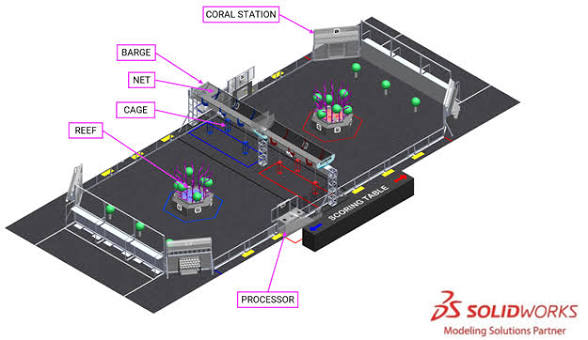
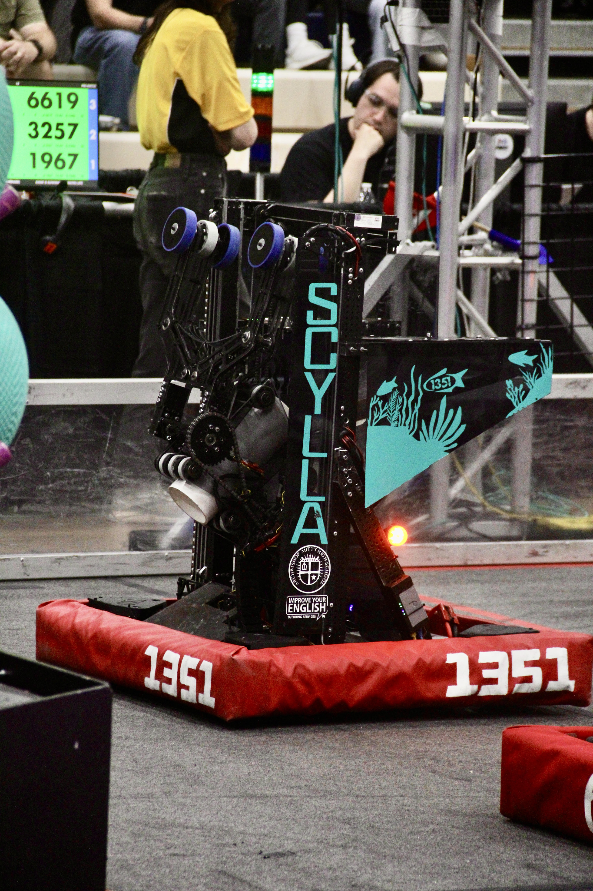
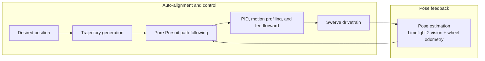
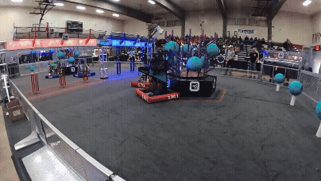

# Reef Auto-Alignment and Localization — 2025 FRC REEFSCAPE

**Java · Swerve Drive · Auto-Alignment · Pose Estimation · Trajectory Generation · Pure Pursuit · Motion Control**

I developed the reef auto-alignment system for a 2025 FIRST Robotics Competition (FRC) robot during the REEFSCAPE season. The system automatically positioned the robot at reef scoring locations and was used during both autonomous and teleoperated operation.

In REEFSCAPE, each alliance has a **reef**, a hexagonal field structure with branches where robots score coral. The goal of this project was to allow the robot to accurately and repeatably align with selected scoring positions on its alliance's reef.

The auto-alignment system combined vision and wheel odometry for pose estimation, on-the-fly trajectory generation, Pure Pursuit path following, and drivetrain control.

**My role:** Software Lead  
**Team contribution:** Mentored five students on the software team  
**Engineering focus:** Auto-alignment, localization, trajectory generation, path following, and swerve-drive control

This repository is a technical overview of my contributions. It documents the system design and engineering work without reproducing team-owned source code.

## Game context

The field layout below shows the REEFSCAPE playing field, with the reef highlighted. This is the scoring structure that the auto-alignment system was designed to target.

*2025 REEFSCAPE field layout. The reef is the structure where robots score coral on designated branches. Field overview based on the [official 2025 REEFSCAPE game manual](https://firstfrc.blob.core.windows.net/frc2025/Manual/2025GameManual.pdf).*

### The Robot

This is Team 1351's robot from the 2025 REEFSCAPE season. I developed the auto-alignment software for it and integrated it with the swerve drivetrain.

---

## Project at a glance

| Area | Work | Technologies |
|---|---|---|
| Auto-alignment | Developed robot auto-alignment functionality for reef scoring positions during both autonomous and teleoperated operation | Java, swerve drive |
| Localization | Combined Limelight 2 vision measurements with swerve wheel odometry using a Kalman filter | Java, Limelight 2, wheel odometry |
| Trajectory generation | Generated quintic Hermite splines on the fly using the robot's current position and velocity and the desired position and velocity | Java, quintic Hermite splines |
| Path following | Followed generated trajectories using Pure Pursuit with an 8-inch lookahead distance | Pure Pursuit |
| Motion control | Used PID, motion profiling, and feedforward for drivetrain control | PID, motion profiling, feedforward |
| Swerve integration | Integrated the auto-alignment software with the robot's swerve drivetrain and CTRE-based hardware | CTRE Phoenix 6, TalonFX, Kraken motors, CANcoders, Pigeon2 |
| Debugging and tuning | Used telemetry and visualization tools to inspect robot behavior | AdvantageScope |

## 1. Auto-alignment objective and operation

The primary goal of this project was to develop a system that could automatically position the robot at selected reef scoring locations.

The auto-alignment feature was used during both autonomous and teleoperated operation:

- **Autonomous:** The auto-alignment functionality was executed as part of the robot's autonomous routine.
- **Teleoperated:** The driver held a button to initiate alignment with a selected reef scoring position. The robot then automatically adjusted its position. Once alignment was complete, the operator could perform the scoring action.

The positioning task was designed around an approximately **2-inch error tolerance**, making reliable localization and trajectory control important to the alignment process.

## 2. Localization and pose estimation

Accurate alignment required the robot to estimate its position and orientation on the field. I worked on combining **Limelight 2 vision measurements** with **swerve wheel odometry** through a Kalman-filter-based pose estimator.

The estimator combined camera-based observations with motion information from the drivetrain. Pose estimation was updated at each timestep, providing the latest estimated robot pose to the alignment and path-following system.

### Localization inputs

- Limelight 2 vision measurements
- Swerve wheel odometry
- Kalman-filter-based pose estimation

## 3. On-the-fly trajectory generation

I implemented **on-the-fly quintic Hermite spline generation** for robot movement toward the desired scoring position.

Rather than relying only on a fixed, pre-generated path, the trajectory was generated using the robot's **current position and velocity** together with the **desired position and velocity**.

This allowed the system to generate a trajectory from the robot's current motion state toward the desired alignment conditions.

## 4. Path following and motion control

The robot used **Pure Pursuit** to follow generated trajectories, with an **8-inch lookahead distance**. The path-following output was integrated with drivetrain control using PID, motion profiling, and feedforward.

### Auto-alignment and pose-estimation feedback

The diagram below summarizes the relationship between trajectory generation, path following, drivetrain control, and pose estimation. The control and drivetrain stages are shown on the left side of the feedback loop, while the pose-estimation inputs and Kalman filter are grouped on the right.

*Conceptual software architecture showing the major stages of the auto-alignment system. It is not a wiring diagram or a complete representation of the team's codebase.*

## 5. Swerve drivetrain integration and tools

The auto-alignment software interfaced with the robot's swerve drivetrain and CTRE-based control hardware. The hardware and development tools used in the project included:

- **Drivetrain and motor control:** Swerve drive, CTRE Phoenix 6, TalonFX, Kraken motors
- **Sensing:** Limelight 2, Pigeon2, CANcoders, wheel odometry
- **Software and debugging:** Java, AdvantageScope
- **Control and estimation:** Kalman filtering, Pure Pursuit, PID, motion profiling, feedforward

## 6. Auto-alignment demonstration

The demonstration below shows the robot executing an autonomous routine using the auto-alignment system. The same alignment functionality was also available during teleoperated operation.

## 7. Role and team contribution

As software lead, I mentored **five students** and developed the robot's reef auto-alignment feature. My work focused on the localization, trajectory generation, path following, and drivetrain control components that enabled the robot to align with reef scoring positions during both autonomous and teleoperated operation.

## Scope and disclosure

This repository is a portfolio overview of my work on a larger team project. It does not include team-owned source code, private repositories, internal documentation, credentials, or unapproved engineering details. The architecture diagram is an explanatory summary, not a released engineering drawing.

---

*2025 FRC REEFSCAPE · Reef Auto-Alignment and Localization*